# ECHO TV - IPTV Player Application

<p align="center">
  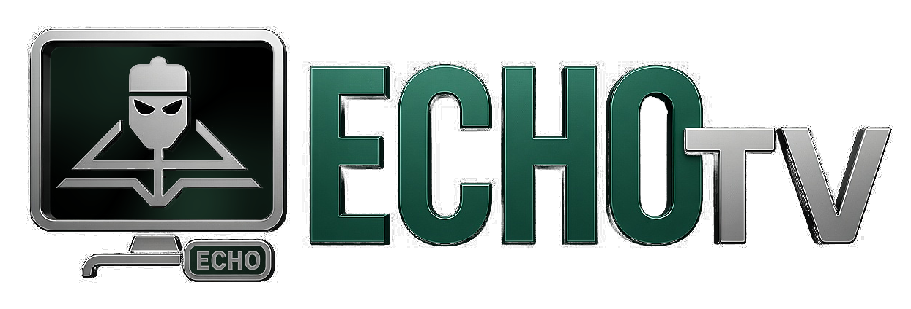
</p>

**Developer:** Antonio Martinovic @ ShadyDevelopment · **[Source and releases](https://github.com/ShadyDevelopment/ECHO_TV)**

**ECHO TV** is a video player application that provides support for IPTV playlist playback (m3u, m3u8). The application allows users to import playlists using remote URLs or by uploading files from the local file system. Additionally, it supports EPG information in XMLTV format which can be provided via URL.

The application is a cross-platform, open-source project built with Electron and Angular.

⚠️ Note: ECHO TV does not provide any playlists or other digital content. The channels and pictures in the screenshots are for demonstration purposes only.

> [!IMPORTANT]
> **Official sources only.** ECHO TV is a free, open-source **player** — it never sells IPTV subscriptions, channels, or playlists. Websites offering "ECHO TV subscriptions/channels/premium/activated" builds are **not affiliated** with this project. Get the app only from [GitHub](https://github.com/ShadyDevelopment/ECHO_TV) or [GitHub Releases](https://github.com/ShadyDevelopment/ECHO_TV/releases).

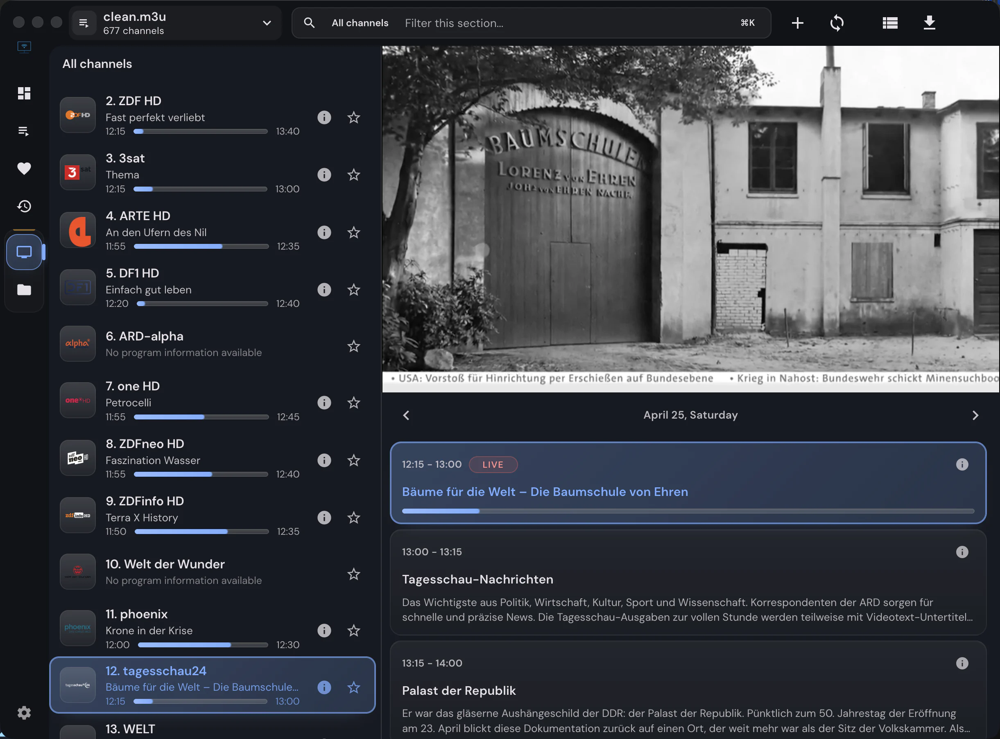

## Features

**Playlists & sources**

- M3U / M3U8 playlists from local files or remote URLs 📂, with automatic updates on startup
- Xtream Codes (XC) and Stalker / Ministra (STB) portal support
- Custom "User-Agent" header per playlist

**Playback**

- Built-in HTML5 player (HLS.js or Video.js) with a resizable, resumable inline view
- Optional unified ECHO TV controls for HTML5, Video.js, and ArtPlayer, enabled in **Settings → Playback** _(experimental)_
- External players — MPV, VLC, and IINA on macOS (`mpv.app` / `VLC.app` bundle paths supported) _(desktop)_
- Embedded MPV — native mpv rendered inside the app window on macOS, Windows & Linux 🖥️ _(experimental · desktop)_
- Dedicated radio player for `radio="true"` streams 📻

**Live TV & EPG**

- EPG / XMLTV TV guide with a live timeline ribbon and multi-channel grid _(desktop)_
- TV archive / catch-up / timeshift _(desktop)_
- Group-based channel list, channel-number selection, and search 🔍

**Movies & series (VOD)**

- Redesigned two-state detail pages (browse ↔ watch) with season tabs and resume positions
- Download manager for offline movies & episodes ⬇️ _(desktop)_
- "Recently added" feeds and category grids with sorting & pagination

**Discovery & metadata**

- Global search across live TV, movies, and series _(desktop)_
- TMDB enrichment (opt-in, requires your own TMDB API key) — plots, cast & crew, trailers, ratings, artwork, a "Similar" rail, clickable actor pages, and a trending dashboard rail _(trending rail: desktop)_
- Dashboard with recently watched & continue-watching

**Organization**

- Per-playlist and global favorites, aggregated across all playlists ⭐
- Recently viewed / watch history
- Command palette (`Ctrl/Cmd+K`) that also finds and opens individual settings
- Settings search from the header search box on the Settings page

**Platform**

- Cross-platform desktop (Electron) and installable PWA
- Desktop auto-updater and mobile remote control _(desktop)_
- Docker self-hosting for the PWA + web backend
- 19 languages ([translation files](apps/web/src/assets/i18n/)), light & dark themes, and keyboard shortcuts

## Keyboard shortcuts

Press `?` or `Shift+/` in the workspace to open the in-app shortcuts list.

| Area              | Shortcut                    | Action                                                     |
| ----------------- | --------------------------- | ---------------------------------------------------------- |
| Global            | `Ctrl/Cmd+K`                | Open command palette                                       |
| Global            | `Ctrl/Cmd+F`                | Open global search (desktop); on Settings, search settings |
| Global            | `Ctrl/Cmd+R`                | Open recently viewed in the desktop app                    |
| Global            | `Enter` in workspace search | Submit the search; on Settings, open the best match        |
| Global            | `F11`                       | Toggle app window fullscreen in the desktop app            |
| Navigation        | `Ctrl/Cmd+B`                | Toggle the live sidebar                                    |
| Navigation        | `0-9`                       | Select an M3U channel by number                            |
| Playback          | `Space` / `K`               | Play or pause playback                                     |
| Playback          | `F`                         | Toggle player fullscreen                                   |
| Playback          | `ArrowLeft` / `ArrowRight`  | Seek VOD playback by 5 seconds                             |
| Playback          | `ArrowUp` / `ArrowDown`     | Adjust volume by 5%                                        |
| Playback          | `M`                         | Mute audio                                                 |
| Dialogs and lists | `ArrowUp` / `ArrowDown`     | Move command palette selection                             |
| Dialogs and lists | `Enter`                     | Run the selected command or open a focused item            |
| Dialogs and lists | `Escape`                    | Close dialogs and dismiss overlays                         |

The desktop app can also open at its last size, maximized, or fullscreen on
every launch (Settings → General → "Window on startup"), and `echo-tv
--fullscreen` forces a single fullscreen launch for TV or HTPC autostart
scripts without changing that setting.

## Screenshots:

|                                     Dashboard with recently watched content                                     |                               Live channels with inline player and EPG                                |
| :-------------------------------------------------------------------------------------------------------------: | :---------------------------------------------------------------------------------------------------: |
|    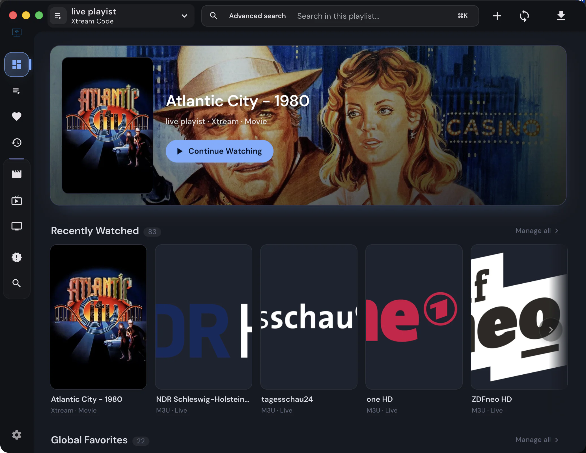    |  |
|                                Add playlist dialog for M3U, Xtream, and Stalker                                 |                                      Live category channel list                                       |
|    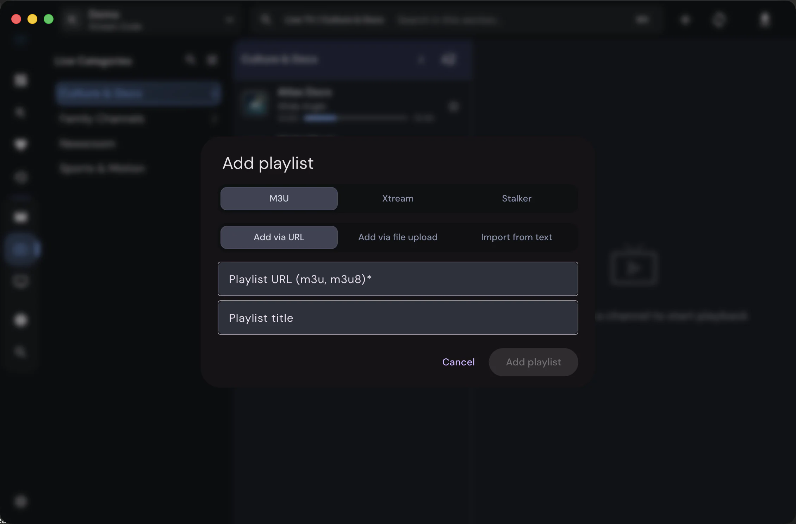     |          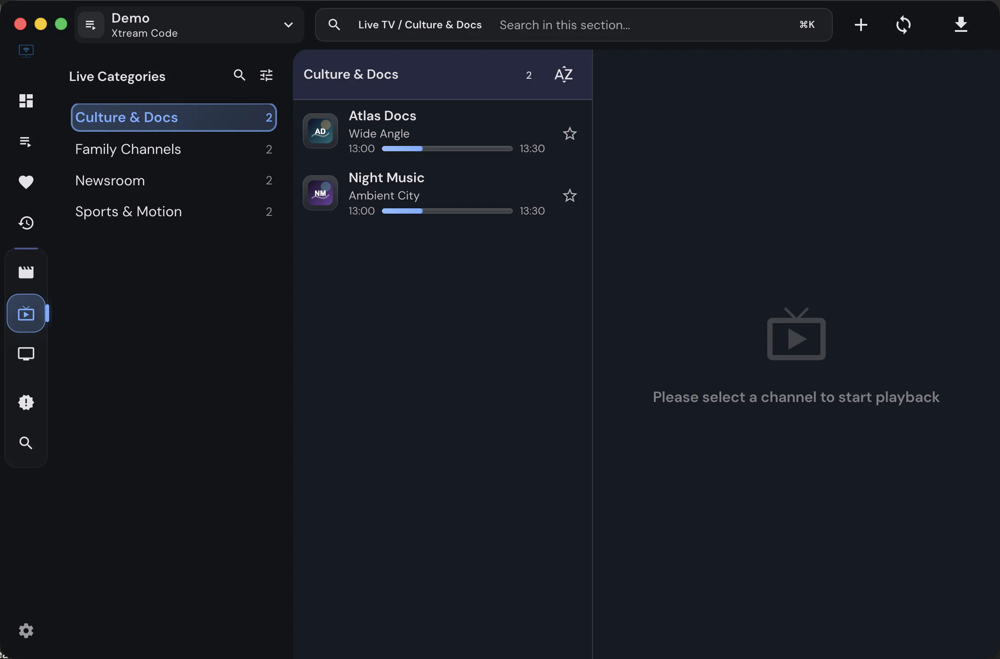          |
|                                Global search across live TV, movies, and series                                 |                                    Manage visible live categories                                     |
|    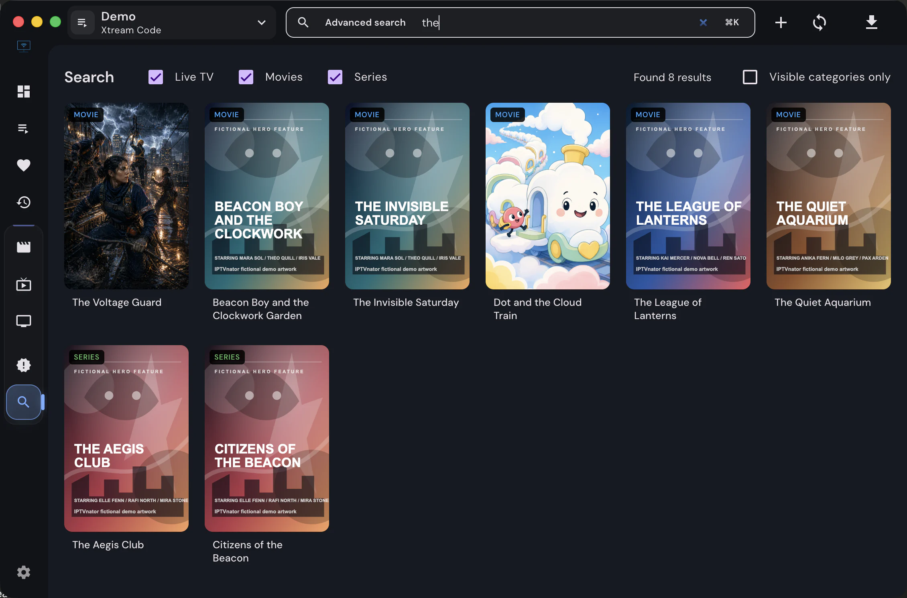    |      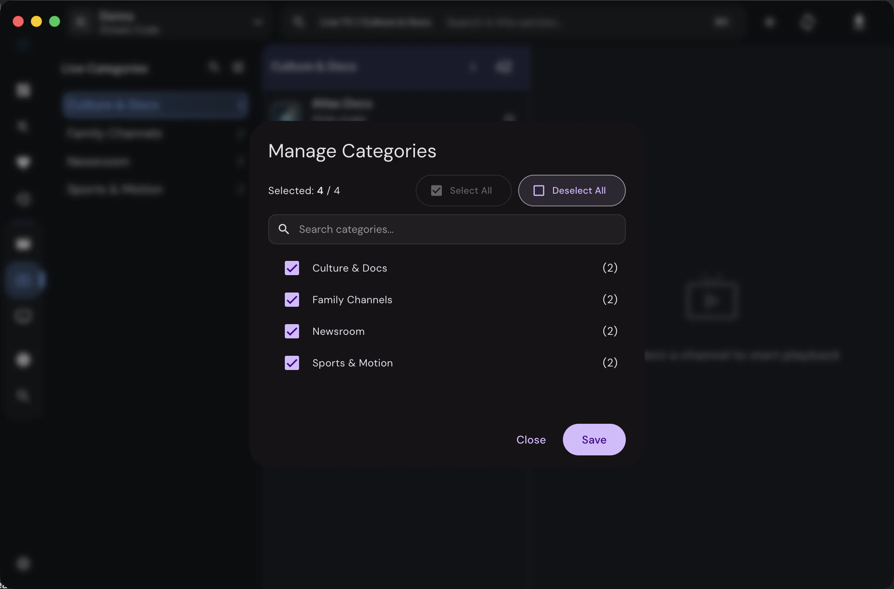      |
|                                 Movie category grid with sorting and pagination                                 |                                   Recently added movies and series                                    |
| 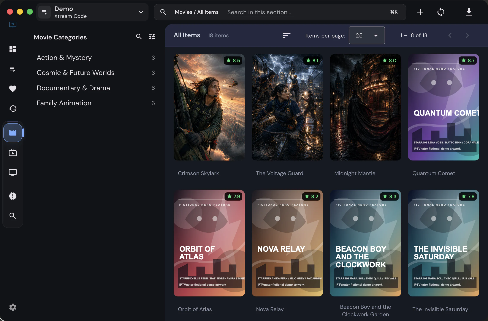 |   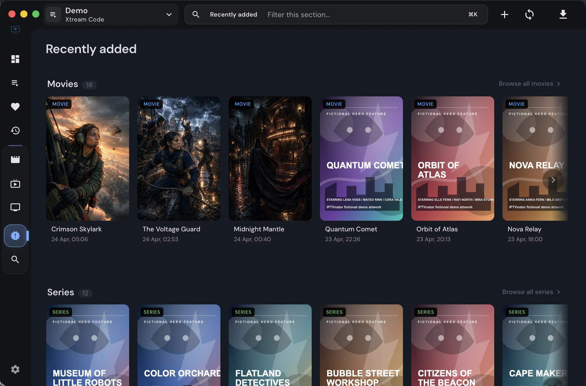   |
|                                 VOD details with playback and download actions                                  |                                           Download manager                                            |
|      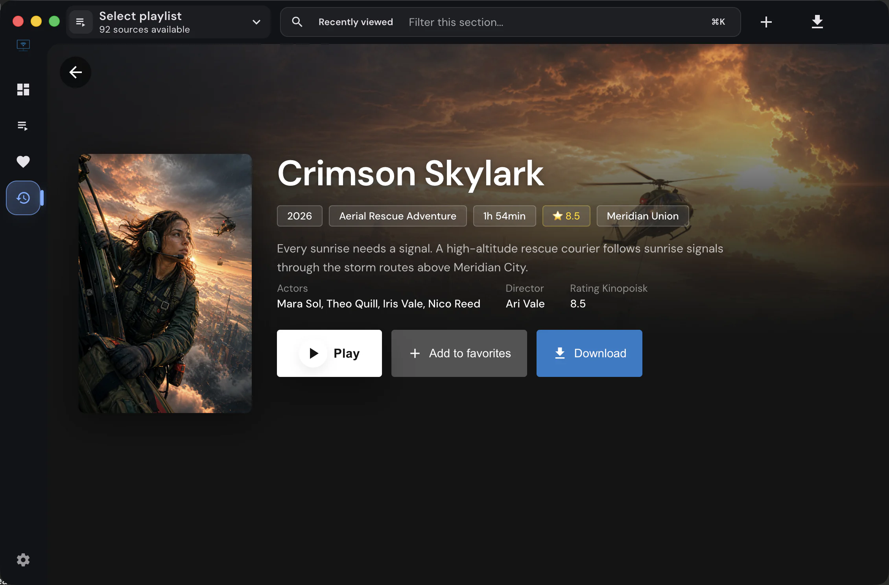      |             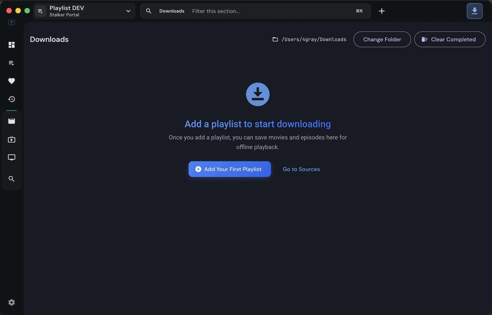              |
|                                             Multi-channel EPG grid                                              |                                      External MPV player support                                      |
|                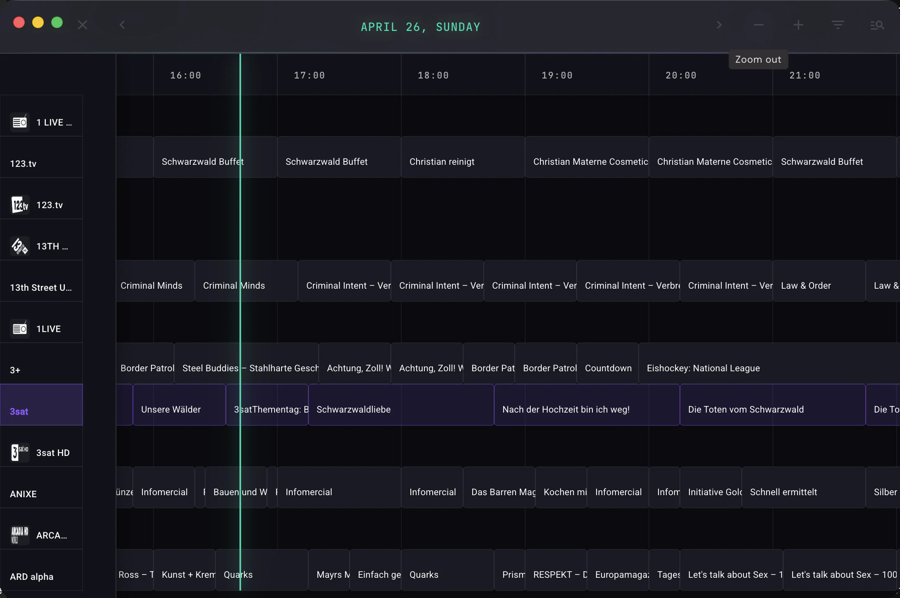                 |  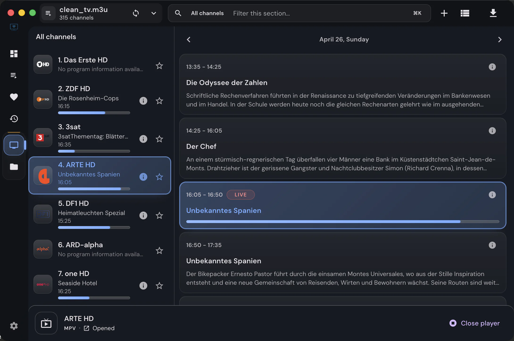   |
|                                   Radio playback with dedicated audio player                                    |                                              Light theme                                              |
|       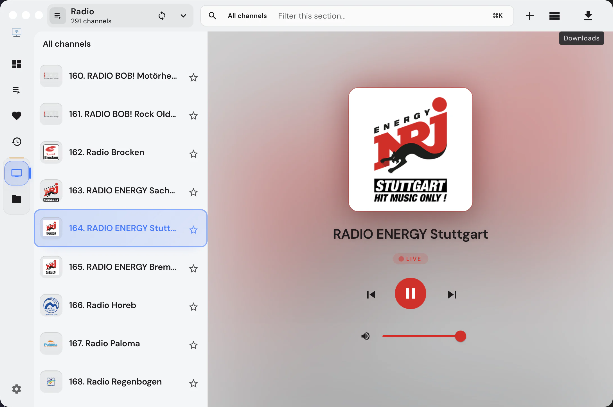       |                  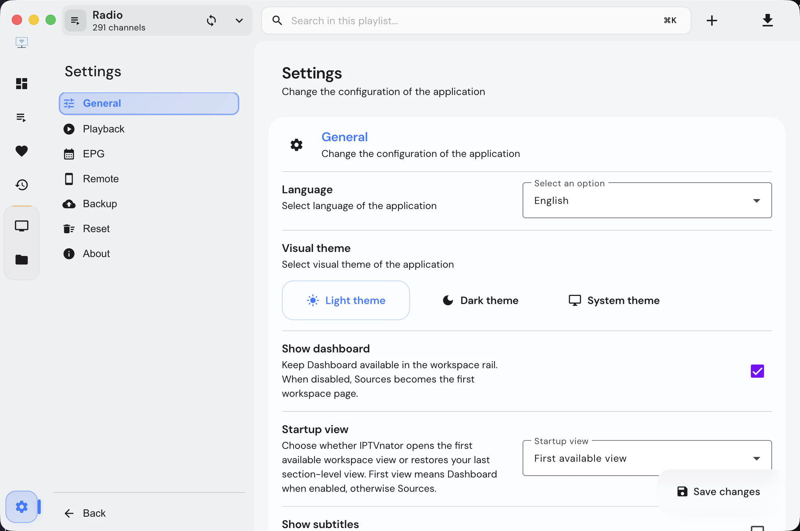                   |
|                                              Application settings                                               |                                                                                                       |
|                    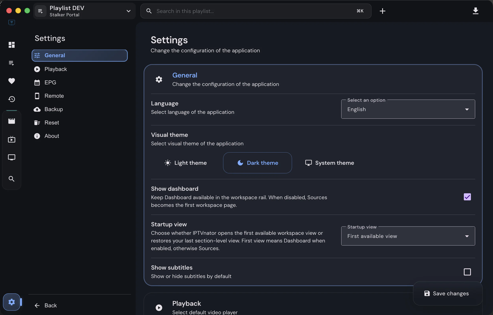                     |                                                                                                       |

_Note: First version of the application which was developed as a PWA is available in an extra git branch._

## Self-hosted PWA

The Docker setup builds the Angular PWA and the monorepo web backend into one
image. The backend handles remote M3U parsing plus Xtream and Stalker proxy
requests under `/api`, so a separate backend container is not
required for the default self-hosted flow.

```bash
docker compose -f docker/docker-compose.yml up --build -d
```

The application is available at <http://localhost:4333>. See
[`docker/docker-compose.yml`](./docker/docker-compose.yml) for the ready-to-run
compose file and [`docker/README.md`](./docker/README.md) for environment
variables, reverse proxy notes, PWA limitations, and build details.

The self-hosted image runs the browser PWA rather than the Electron desktop app:
EPG/XMLTV panels, Embedded MPV, managed MPV/VLC launching, the download manager,
and Electron remote-control features are not available there. If browser
playback fails, copy the stream URL and open it manually in an external player
such as MPV, VLC, or IINA.

## Download

Download the latest version of the application for macOS, Windows, and Linux from the [release page](https://github.com/ShadyDevelopment/ECHO_TV/releases).

Official desktop installers are published on the GitHub Releases page. Third-party
package repositories may still use legacy package names and are maintained
outside this repository.

### Nightly builds

Every merge into `master` is published as a prerelease in the
[ECHO TV nightly releases](https://github.com/ShadyDevelopment/ECHO_TV-nightly). The
desktop app can follow them: **Settings → About → Update channel → Nightly**
offers each new build through the built-in updater (macOS, Windows, and the
Linux AppImage). Nightly builds are untested snapshots — they may break, and
their database changes are permanent, so switching back to **Stable** keeps
the installed nightly until the next stable release is newer. Back up your
playlists first, and mention the version and commit shown in *About* when
reporting a bug from a nightly.

### Linux Embedded MPV Support

Embedded MPV on Linux is experimental and currently supports x64 desktop
sessions where ECHO TV runs under X11 or Xwayland. Native Wayland embedding
is not supported yet. Linux package launchers request X11 with
`--ozone-platform=x11`, so Wayland desktops still need Xwayland available.

The Linux backend starts a system `mpv` executable with `--wid`, so `mpv` must
be installed and available on `PATH`. CI validates the Linux native addon and
standard packages on Ubuntu 22.04, with Flatpak packaging built on Ubuntu 24.04.
Expected user targets are Ubuntu/Debian `.deb`, Arch/Manjaro `pacman`, RPM
distributions, and AppImage on x64 systems with X11/Xwayland plus `mpv`
installed. Flatpak and Snap builds remain available, but embedded MPV is not
announced as supported there yet because those sandboxed formats do not expose
the host `mpv` executable to the embedded backend by default.

## Troubleshooting

### macOS: "App is damaged and can't be opened"

Older unsigned macOS builds may require removing the quarantine flag from the downloaded application:

```bash
xattr -c /Applications/ECHO TV.app
```

Alternatively, if the app is located in a different directory:

```bash
xattr -c ~/Downloads/ECHO TV.app
```

### Linux: chrome-sandbox Issues

If you encounter the following error when launching ECHO TV:

```
The SUID sandbox helper binary was found, but is not configured correctly.
Rather than run without sandboxing I'm aborting now.
You need to make sure that chrome-sandbox is owned by root and has mode 4755.
```

**Solution 1: Fix chrome-sandbox permissions (Recommended for .deb/.rpm installations)**

Navigate to the ECHO TV installation directory and run:

```bash
sudo chown root:root chrome-sandbox
sudo chmod 4755 chrome-sandbox
```

**Solution 2: Launch with --no-sandbox flag**

Edit the desktop launcher file to add the `--no-sandbox` flag:

1. Find your desktop file location:
    - **Ubuntu/Debian**: `~/.local/share/applications/com.shadydevelopment.echotv.desktop`
    - **System-wide**: `/usr/share/applications/com.shadydevelopment.echotv.desktop`

2. Edit the file and modify the `Exec` line:

    ```
    Exec=echo-tv --no-sandbox %U
    ```

3. Save the file and relaunch the application from your application menu.

Alternatively, you can launch ECHO TV from the terminal with the flag:

```bash
echo-tv --no-sandbox
```

### GNU/Linux: Wayland startup failure

If ECHO TV exits on GNU/Linux with errors about failing to connect to
Wayland or initialize the Ozone platform, force X11/XWayland instead:

```bash
echo-tv --ozone-platform=x11
```

This workaround is mainly for older or problematic Linux graphics stacks. The
Snap package already includes this X11 override by default. For AppImage,
direct binaries, and other Linux package formats, pass the flag manually when
needed.

## How to Build and Develop

Requirements:

- Node.js 22.22.3 or newer within 22.x, or 24.15.0 or newer within 24.x
- pnpm 10.33.0 (via Corepack)

The repository's `.nvmrc` pins the Node.js version used by CI. With nvm,
run `nvm install` and `nvm use` from the repository root to use the same version
for local development.

1. Clone this repository and install project dependencies:

    ```
    $ nvm install
    $ nvm use
    $ corepack enable
    $ pnpm install
    ```

2. Start the application:
    ```
    $ pnpm run serve:backend
    ```

This will open the Electron app in a separate window, while the Angular dev server will run at http://localhost:4200.

The equivalent Nx command is:

```
$ nx serve electron-backend
```

To start Electron with an empty, isolated data directory instead of your normal
`~/.echo-tv` folder, set `ECHO_TV_E2E_DATA_DIR` for that run:

```
$ rm -rf .tmp/echo-tv-empty && mkdir -p .tmp/echo-tv-empty
$ ECHO_TV_E2E_DATA_DIR="$PWD/.tmp/echo-tv-empty" pnpm run serve:backend
```

This redirects the SQLite database, Electron user data, and local config under
the given directory. Delete that directory whenever you want a fresh empty
state.

If you need startup diagnostics for a white screen or a frozen route, you can
also turn on opt-in Electron tracing. These logs are written to the Electron
terminal output so they still help when the renderer DevTools never open:

```
$ ECHO_TV_TRACE_STARTUP=1 pnpm run serve:backend
```

Nx equivalent:

```
$ ECHO_TV_TRACE_STARTUP=1 nx serve electron-backend
```

Useful narrower flags:

- `ECHO_TV_TRACE_IPC=1` logs renderer `window.electron.*` calls reaching the
  Electron bridge
- `ECHO_TV_TRACE_DB=1` logs DB worker requests and request-scoped DB events
- `ECHO_TV_TRACE_SQL=1` logs SQLite statements in both the main connection and
  DB worker connection
- `ECHO_TV_TRACE_WINDOW=1` logs BrowserWindow load, navigation, and
  unresponsive events
- `ECHO_TV_TRACE_RENDERER_CONSOLE=1` mirrors renderer console messages into
  the Electron terminal output

Security-sensitive network compatibility flags are opt-in:

- `ECHO_TV_ALLOW_PRIVATE_NETWORK_URLS=1` permits strict EPG fetches from
  playlist metadata (`x-tvg-url`, `url-tvg`, or `tvg-url`) to resolve to
  localhost, LAN, or other private addresses. Directly configured
  Xtream/Stalker portals and private playlist servers remain supported without
  this flag. Prefer the in-app source-scoped “Allow source” action for a trusted
  EPG URL.
- `ECHO_TV_ALLOW_INSECURE_TLS=1` disables certificate validation for remote
  playlist imports and refreshes for the whole Electron process. Prefer the
  in-app host-scoped trust action for a trusted provider with a self-signed or
  otherwise invalid certificate.

If the local Nx daemon gets into a bad state before rerunning Electron, reset it:

```
$ pnpm nx reset
```

To run only the Angular app without Electron, use:

```
$ pnpm run serve:frontend
```

To see how many bytes the built web app puts on the initial load path (the
number the CI ratchet guards), build it and run the measurement:

```
$ pnpm nx build web
$ pnpm run perf:initial-bytes
```

The contract behind that number is in
[docs/architecture/performance-journeys.md](docs/architecture/performance-journeys.md).

To benchmark the "launch to usable", "open a source" and "start playback"
journeys (fresh Electron processes on a seeded profile against the local
Xtream mock, exact renderer counters plus wall-clock), run:

```
$ pnpm run perf:journeys
```

The journeys, their counters and the summary written under
`dist/performance/journeys/` are described in
[docs/architecture/performance-journeys.md](docs/architecture/performance-journeys.md).
`pnpm run perf:compositing` measures the renderer's tile memory and composited
layers on the dashboard, the detail pages, Live TV and settings (the
"compositing budget" section of the same document).

## Disclaimer

**ECHO TV doesn't provide any playlists or other digital content.**

## Trademark

The name **"ECHO TV"** and the ECHO TV logo are unregistered trademarks of the project owner. The MIT license covers the source code only — it does **not** grant rights to the name or logo. Forks and redistributions (including app-store submissions) must use a different name and their own icon. See [TRADEMARK.md](./TRADEMARK.md) for details.

<!-- ALL-CONTRIBUTORS-BADGE:START - Do not remove or modify this section -->

[](#contributors)

<!-- ALL-CONTRIBUTORS-BADGE:END -->

## Developer and agent documentation

Start with the [task context map](docs/maintenance/agent-context-map.md) to find
the authoritative contract and validation for your area. Common agent rules are
in [AGENTS.md](AGENTS.md); Claude Code imports that same file. Development and
documentation-maintenance conventions live in the
[agent workflow](docs/development/agent-workflow.md).
